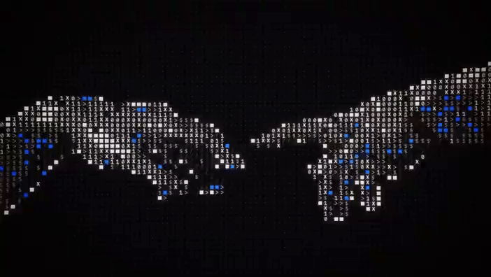

  

<h1 align="center">Hi 👋🏻, Ahlam Garah</h1>

<h3 align="center">Frontend Engineer & UI/UX Designer</h3>

  

<h2 align="center">🚀 About Me</h2>

So here's the coffee ☕ I'm a Frontend Engineer student and UI/UX Designer, passionate about turning ideas into clean, interactive, and meaningful digital experiences.

I spend my time exploring designs, writing code, experimenting with interfaces, and figuring out how to make things look good *and* work beautifully.

My process usually goes something like: imagine an idea → design it → bring it to life with code → break something → fix it → question my entire existence → finally make it work.

I'm all about creativity, curiosity, and learning by building. Always exploring new technologies, sharpening my design eye, and turning random ideas into real projects, one pixel and one line of code at a time.

Still learning, constantly creating, and probably drinking coffee while doing it. ☕

 

<h2 align="center">🤝 Connect</h2>

<h2 align="center">💻 Tech Stack</h2>

  <!-- Design & Development Tools -->
  
  
  

  <!-- Frontend Technologies -->
  
  
  
  
  
  
  

<h2 align="center">⌘ Commit Activity</h2>

  

<h2 align="center">⌘ Quote</h2>

  <em>"Building experiences, one pixel at a time."</em>
   
  — Me

